# Traject architecture (October 2026)

## System architecture diagram

```mermaid
flowchart LR
    User[Revenue user] --> Browser[React + Vite frontend]
    Browser -->|Email and password| Identity[Accounts service]
    Identity -->|Tenant ID and API key| Browser
    Browser -->|Tenant headers + REST| API[FastAPI API]

    API --> Auth[Tenant authorization]
    Auth --> DB[(SQLite tenant store)]
    API --> Web[Frontend API adapter]
    Web --> Pipeline[Recommendation pipeline]
    Web --> Chat[Tenant chat agent]
    Web --> Actions[Email and meeting services]

    Uploads[CSV / XLSX tenant files] --> Ingestion[Schema-free ingestion]
    Ingestion --> Discovery[Schema Discovery]
    Discovery --> Prompt[Prompt Architect]
    Prompt --> Correction[Bounded self-correction]
    Correction --> DB

    Pipeline --> Screen[Deterministic risk and evidence gates]
    Screen --> Catalog[Eligible catalog retrieval]
    Catalog --> Recommend[Recommendation agent]
    Recommend --> Critic[Independent Critic agent]
    Recommend --> Gateway[IndiaAI client and retry policy]
    Critic --> Gateway
    Chat --> Gateway
    Gateway --> Qwen[MAQ IndiaAI Qwen]
    Critic --> Value[Confidence and deal value]
    Value --> DB
    DB --> Web
```

The browser never chooses the database tenant directly. Protected routes validate
the tenant header and API key, then use the verified tenant identifier for every
read and write.

## Runtime boundaries

| Layer | Primary files | Responsibility |
|---|---|---|
| UI | `frontend/src/pages`, `frontend/src/components` | Dashboard, customer analysis, opportunity tracking, chat |
| API | `backend/app/main.py`, `backend/app/web_api.py` | FastAPI HTTP routing, Pydantic contracts, tenant authorization |
| Identity | `backend/app/accounts.py`, `backend/app/auth.py` | Password verification and tenant-scoped API keys |
| Ingestion | `backend/scripts/run_tenant_ingestion.py`, `backend/app/schema_*`, `backend/app/data_ingestion.py` | Tenant CSV discovery, column mapping, normalized records |
| Decisions | `backend/app/pipeline.py`, `backend/app/prefilter.py`, `backend/app/trust.py` | Prefilter, compatible catalog retrieval, deterministic vetoes and abstention |
| Agents | `backend/app/agents/workflow.py`, `backend/app/agents/clients.py` | Recommendation and independent Critic with validated structured outputs |
| Model gateway | `backend/app/indiaai_client.py`, `backend/app/llm_retry.py` | IndiaAI Qwen-only OpenAI-compatible client and bounded retries |
| Storage | `backend/app/db.py`, `backend/data/schema.sql` | SQLite tenant-scoped persistence |

## Decision pipeline

1. Authenticate caller from `X-Tenant-Id` and `X-API-Key` headers.
2. Read only the tenant's accounts, support signals, usage and eligible catalog products.
3. Deterministically screen evidence and risk before spending model tokens.
4. Ask Qwen for an evidence-constrained recommendation; validate JSON with Pydantic.
5. Give raw evidence and the proposed product to a separate Critic prompt.
6. Enforce eligibility, Critic veto, evidence gates and fail-closed fallback behavior.
7. Store outcome and trace for the dashboard.

The Recommendation and Critic are *separate agent instructions*, not different models. Both share one client connection pool against the configured Qwen deployment; the Critic has an independent prompt and a distinct judgement. Failures safely yield no approved upsell.

## Key runtime contracts

- `tenant_schema_columns` stores discovered meaning without renaming source data.
- `tenant_records` keeps complete source rows as JSON and their resolved entity ID.
- Deterministic adapters expose customer, usage, ticket, and catalog shapes to
  calculations while preserving other columns as dynamic evidence.
- `RecommendationDraft`, `CriticVerdict`, and related Pydantic models validate
  structured model responses before workflow code accepts them.
- Recommendation traces record candidates, gates, fallbacks, critic decisions,
  confidence, and deal-value anomalies.

## Project organization and local startup

- `backend/app`: API, domain logic, model adapter, and persistence. The large `db.py`, `chat_agent.py`, and `web_api.py` remain cohesive legacy modules; future domain-specific extraction should be performed incrementally with regression tests.
- `backend/scripts`: ingestion, data-generation and diagnostic CLIs.
- `backend/tests`: backend contract and trust-gate tests; network calls are mocked except explicitly opt-in live tests.
- `demo_data`: curated synthetic 12-account showcase and 36-account benchmark.
- `backend/data/tenant_uploads`: generated demo copies or runtime tenant inputs. No tenant CSVs are tracked in Git.
- `frontend/src/api`: browser's tenant-scoped API client.

See the root README for commands; GitHub Actions runs backend tests and frontend build on pushes and pull requests.

## Known production-hardening work (not claimed complete)

- Replace the SQLite/thread-based local ingest jobs with a queue and stronger transactional/idempotency guarantees for scale.
- Split large HTTP handlers and persistence methods into domain modules once integration test coverage is expanded.
- Replace browser `sessionStorage` API-key auth with robust server-managed sessions, expirations and CSRF protections for production.
- Require secure per-deployment `API_KEY_SALT`, HTTPS, deployment-specific CORS, and authorization before the private model gateway is used.
- Keep all tenant uploads untracked, and verify that confidential records never enter a commit.
- Benchmark live gateway latency, JSON success rate, failure recovery and human-labeled quality.
