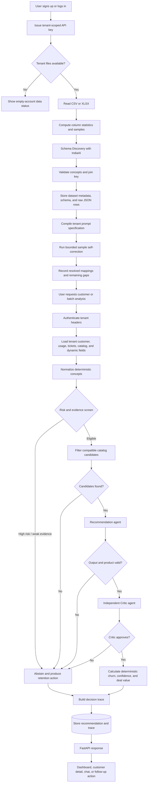
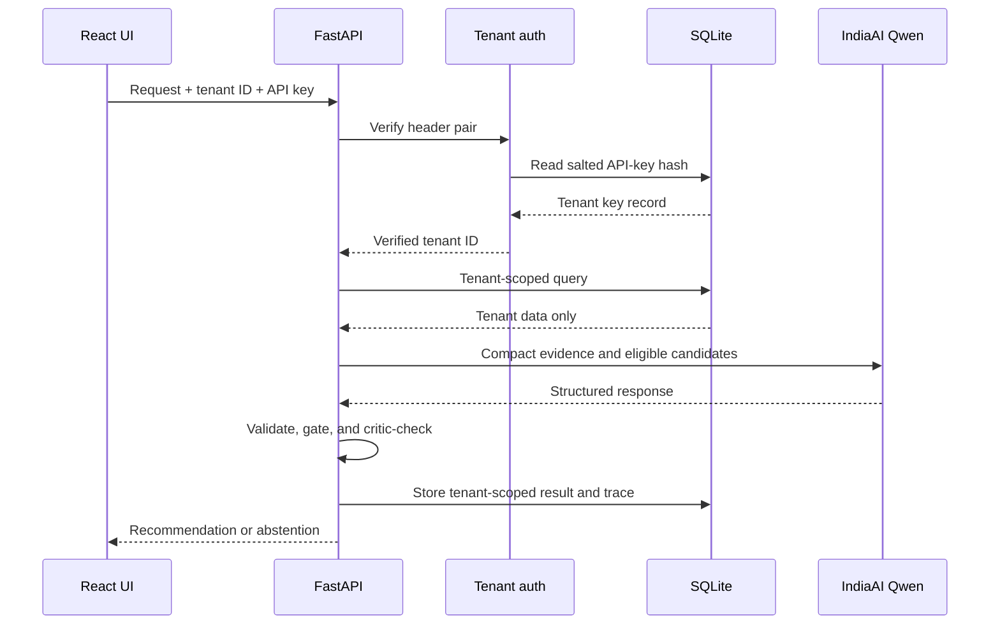

# Traject data flow

## End-to-end data flow diagram

## Ingestion transformations

| Input | Transformation | Stored result |
|---|---|---|
| File name and headers | Used as hints, never as the only evidence | Dataset label and exact source column names |
| Column values and statistics | Type, role, relevance, and meaning inference | Schema catalog entries |
| Customer/account identifier | Join-key validation | `entity_id` used across tenant datasets |
| Usage time series | Primary trend metric selection | Comparable trend rows for deterministic calculations |
| Support records | Severity, time, resolution, category, and subject concepts | Normalized ticket evidence plus raw fields |
| Product catalog | Product identity, name, tier, category, price, and description | Eligible products and deal-value inputs |
| Unrecognized columns | Preserved without forcing a concept | Dynamic fields available to agents and insights |

## Recommendation data contract

The model receives compact normalized signals, relevant raw schema-free rows, and
only the eligible product candidates. The final record contains:

- customer and renewal identifiers from stored source data;
- deterministic churn risk and reason;
- an approved catalog product or an explicit abstention reason;
- recommendation type, evidence-grounded rationale, and revenue score;
- confidence based on model confidence, data completeness, retrieval fit, and
  critic penalty;
- incremental upgrade or full cross-sell deal value;
- an agent trace showing gates, candidates, critic verdict, and fallbacks.

## Tenant and trust boundaries

Raw API keys and passwords are not stored in plaintext. Tenant uploads, runtime
databases, logs, and `.env` files are excluded from Git.
